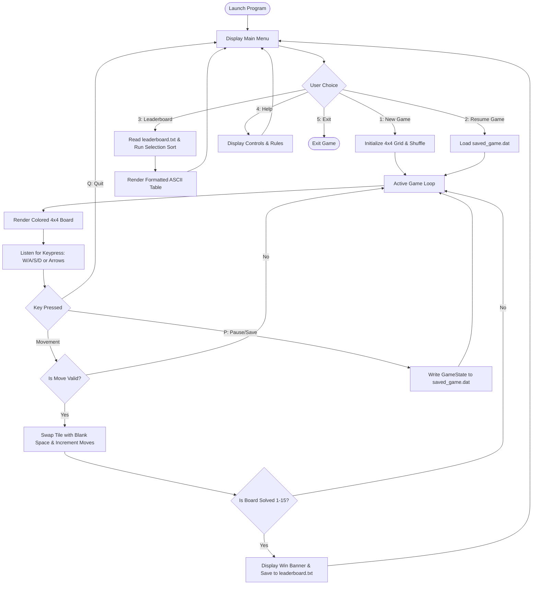

# The 15-Puzzle Terminal Game (Mini Project)

An interactive, retro ANSI terminal sliding tile game built in pure C, featuring a modular architecture with explicit **Front-End** and **Back-End** separation.

---

## 1. Problem Definition
The 15-Puzzle is a classic sliding tile puzzle consisting of a $4 \times 4$ frame of numbered square tiles (from 1 to 15) and one empty position. The objective of the puzzle is to place the tiles in numerical order (left-to-right, top-to-bottom) by making sliding moves that use the empty space.

The system addresses the challenge of:
- Modeling a 2D dynamic grid in memory.
- Ensuring every generated puzzle is mathematically **solvable** before presentation.
- Providing an intuitive, flicker-free terminal interface.
- Persisting high scores and active game sessions to secondary storage.

---

## 2. Objectives
1. Implement a complete game engine in C utilizing core data structures (2D arrays, custom structs).
2. Separate presentation logic (**Front-End**) from business logic and persistence (**Back-End**).
3. Demonstrate mathematical verification of solvability using **Recursion** (counting inversions).
4. Implement a ranking system using **Selection Sort** to rank players by fewest moves and lowest time.
5. Provide persistent data storage via **File Handling** (text-based leaderboard & binary save states).

---

## 3. Syllabus Concepts Coverage

| Syllabus Topic | Implementation in this Project | Code Location |
| :--- | :--- | :--- |
| **2D Arrays** | $4 \times 4$ integer matrix `board[4][4]` representing grid tiles | [`backend.h`](file:///Users/naveen/BOSS/MCA/PSPL_mini_project/15_puzzle/backend.h#L22), [`backend.c`](file:///Users/naveen/BOSS/MCA/PSPL_mini_project/15_puzzle/backend.c#L17) |
| **1D Arrays** | Flattened $1 \times 15$ array used for calculating mathematical inversions | [`backend.c`](file:///Users/naveen/BOSS/MCA/PSPL_mini_project/15_puzzle/backend.c#L73) |
| **Recursion** | `countInversionsRecursive(arr, n)` to count array inversions for solvability | [`backend.c`](file:///Users/naveen/BOSS/MCA/PSPL_mini_project/15_puzzle/backend.c#L46) |
| **Structures** | `struct GameState` (game session data) & `struct LeaderboardEntry` (player records) | [`backend.h`](file:///Users/naveen/BOSS/MCA/PSPL_mini_project/15_puzzle/backend.h#L12-L29) |
| **Loops** | Nested `for` loops for matrix traversal, game loops, move scanning | Throughout `backend.c` & `frontend.c` |
| **Sorting Algorithm** | **Selection Sort** in `sortLeaderboard()` to rank top players | [`backend.c`](file:///Users/naveen/BOSS/MCA/PSPL_mini_project/15_puzzle/backend.c#L201) |
| **File Handling** | `fopen`, `fprintf`, `fscanf` for `leaderboard.txt` and `fwrite`, `fread` for `saved_game.dat` | [`backend.c`](file:///Users/naveen/BOSS/MCA/PSPL_mini_project/15_puzzle/backend.c#L226) |
| **Pattern / Box Drawing** | ANSI box borders (`┌───┬───┐`, `│`, `└───┴───┘`) and color highlighting | [`frontend.c`](file:///Users/naveen/BOSS/MCA/PSPL_mini_project/15_puzzle/frontend.c#L97) |

---

## 4. System Architecture & Flowchart

### Front-End vs Back-End Architecture

```
+-----------------------------------------------------------+
|                      USER INTERFACE                       |
|   (Terminal Screen, ANSI Colors, Box Grid, Instant Keys)  |
+-----------------------------------------------------------+
                             │
                             ▼
+-----------------------------------------------------------+
|                  FRONT-END (frontend.c)                   |
| - clearScreen(), renderBanner(), renderMenu()             |
| - renderBoard() [highlights correctly positioned tiles]   |
| - enableRawMode() / disableRawMode() [termios key reads]  |
+-----------------------------------------------------------+
                             │ Function calls & Game State
                             ▼
+-----------------------------------------------------------+
|                   BACK-END (backend.c)                    |
| - Board state manipulation (moveTile, initBoard)          |
| - Solvability engine (countInversionsRecursive)           |
| - High-score ranker (sortLeaderboard via Selection Sort)  |
| - File persistence (saveScore, saveGameProgress)          |
+-----------------------------------------------------------+
                             │
                             ▼
+-----------------------------------------------------------+
|                   DATABASE / FILE STORAGE                 |
| - leaderboard.txt (Plain text Hall of Fame)               |
| - saved_game.dat (Binary serialization of GameState)      |
+-----------------------------------------------------------+
```

### Game Flowchart



---

## 5. How to Compile & Run

### Using Make:
```bash
cd 15_puzzle
make
./15_puzzle_game
```

### Or Compiling Manually with GCC:
```bash
cd 15_puzzle
gcc -Wall -Wextra -std=c99 main.c backend.c frontend.c -o 15_puzzle_game
./15_puzzle_game
```

---

## 6. Sample Inputs & Outputs

### Main Menu:
```
=====================================================
   __  ____     ___  __  __________   __    ____     
  /  |/  / |   / _ \/ / / /_  /_  /  / /   / __/     
 / /|_/ /| |  / ___/ /_/ / / / / /__/ /___/ _/       
/_/  /_/ |___/_/   \____/ /___/____/_____/___/       
=====================================================

           --- MAIN MENU ---

  [1] Start New Game
  [2] Resume Saved Game (Saved File Found)
  [3] View Hall of Fame (Leaderboard)
  [4] How to Play / Rules
  [5] Exit

Select an option [1-5]: 
```

### Game Board (In-Game View):
```
=====================================================
                THE 15-PUZZLE CHALLENGE              
=====================================================
Player: Naveen         | Moves: 14    | Time: 00:23
-----------------------------------------------------

       ┌──────┬──────┬──────┬──────┐
       │   1  │   2  │   3  │   4  │
       ├──────┼──────┼──────┼──────┤
       │   5  │   6  │  ░░  │   7  │
       ├──────┼──────┼──────┼──────┤
       │   9  │  10  │  11  │   8  │
       ├──────┼──────┼──────┼──────┤
       │  13  │  14  │  15  │  12  │
       └──────┴──────┴──────┴──────┘

Controls: [W/▲ Up] [S/▼ Down] [A/◄ Left] [D/► Right]
          [P] Save Game   [Q] Quit to Menu
```
*(Tiles in green represent already correctly placed tiles, while yellow represents out-of-place tiles)*

### Leaderboard View (Selection-Sorted):
```
  ┌──────┬──────────────────────┬─────────┬──────────┬────────────┐
  │ Rank │ Player Name          │ Moves   │ Time     │ Date       │
  ├──────┼──────────────────────┼─────────┼──────────┼────────────┤
  │ 1    │ Alice                │ 42      │ 01:05    │ 2026-11-10 │
  │ 2    │ Charlie              │ 55      │ 01:30    │ 2026-11-12 │
  │ 3    │ Bob                  │ 68      │ 01:52    │ 2026-11-11 │
  └──────┴──────────────────────┴─────────┴──────────┴────────────┘
```

---

## 7. Viva Voce Q&A Preparation (For Lab Evaluation)

**Q1: How do you guarantee the randomized puzzle is always solvable?**
> **Answer:** In a 15-Puzzle, arbitrary tile permutations have a 50% chance of being mathematically impossible to solve. Our implementation guarantees solvability in two ways:
> 1. The randomizer starts from the solved state and performs valid random moves, ensuring a legitimate permutation path.
> 2. We implemented `isSolvable()` using recursion: we flatten the 2D grid into a 1D array and use `countInversionsRecursive()` to count inversions. On a $4 \times 4$ grid, solvability depends on whether the blank space is on an even or odd row from the bottom combined with whether the inversion count is odd or even.

**Q2: What is the time complexity of the sorting algorithm used?**
> **Answer:** We used **Selection Sort** (`sortLeaderboard()`). It has a time complexity of $O(n^2)$ and space complexity of $O(1)$. It repeatedly finds the minimum element (fewest moves) from the unsorted sub-array and places it at the beginning.

**Q3: Why did you separate front-end and back-end?**
> **Answer:** Following the single responsibility principle: `backend.c` contains only data manipulation, mathematical verification, sorting, and file I/O with no formatting code. `frontend.c` handles user input capture (using POSIX `termios`) and display rendering. If we want to replace the terminal with a web or GUI front-end in the future, the backend logic remains 100% reusable.

**Q4: How does the file handling work?**
> **Answer:** We used two types of file operations:
> - **Formatted Text I/O (`fprintf`, `fscanf`)**: for `leaderboard.txt`, making it human-readable and easy to inspect.
> - **Binary I/O (`fwrite`, `fread`)**: for `saved_game.dat`, saving the complete binary image of `struct GameState` so the game can be resumed exactly where the player left off.
